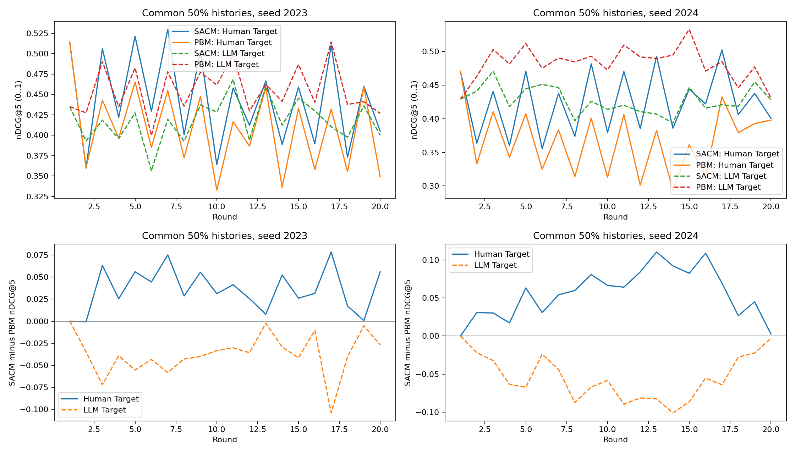

# 公共历史复评：辅助探索

验收通过，2个seed；只验收所选配对运行。

相同50%历史比例和相同具体赋值下，比较不同模型状态。native使用实际反馈比例但新公共随机抽样，并非GPU日志精确重现。

| 指标组 | 指标 | 第2–20轮配对均值 | seed间SD |
|---|---|---:|---:|
| Human | MAP1 | +0.000887 | 0.005465 |
| Human | MAP3 | +0.001439 | 0.003785 |
| Human | MAP5 | +0.000883 | 0.003618 |
| Human | Recall3 | +0.001835 | 0.001233 |
| Human | Recall5 | +0.000000 | 0.000000 |
| Human | nDCG1 | +0.000887 | 0.005465 |
| Human | nDCG3 | +0.001546 | 0.003138 |
| Human | nDCG5 | +0.000671 | 0.002731 |
| Human Target | MAP1 | +0.046722 | 0.015078 |
| Human Target | MAP3 | +0.049576 | 0.014876 |
| Human Target | MAP5 | +0.048304 | 0.014843 |
| Human Target | Recall3 | +0.053805 | 0.015652 |
| Human Target | Recall5 | +0.048135 | 0.015503 |
| Human Target | nDCG1 | +0.046722 | 0.015078 |
| Human Target | nDCG3 | +0.050651 | 0.015056 |
| Human Target | nDCG5 | +0.048336 | 0.014995 |
| LLM | MAP1 | +0.001835 | 0.003020 |
| LLM | MAP3 | -0.000687 | 0.000397 |
| LLM | MAP5 | +0.000166 | 0.000827 |
| LLM | Recall3 | -0.003459 | 0.002127 |
| LLM | Recall5 | +0.000000 | 0.000000 |
| LLM | nDCG1 | +0.001835 | 0.003020 |
| LLM | nDCG3 | -0.001407 | 0.000266 |
| LLM | nDCG5 | +0.000072 | 0.000560 |
| LLM Target | MAP1 | -0.046632 | 0.019204 |
| LLM Target | MAP3 | -0.046892 | 0.015496 |
| LLM Target | MAP5 | -0.047235 | 0.014380 |
| LLM Target | Recall3 | -0.048872 | 0.011314 |
| LLM Target | Recall5 | -0.050331 | 0.006827 |
| LLM Target | nDCG1 | -0.046632 | 0.019204 |
| LLM Target | nDCG3 | -0.047370 | 0.014412 |
| LLM Target | nDCG5 | -0.047979 | 0.012484 |
| dev candidates | exposure@3 | -0.075288 | 0.017892 |
| dev candidates | exposure@5 | -0.052180 | 0.012513 |

指标为0–1；统计单位为seed，无显著性结论。辅助dev曝光不能替代主终点。native与50%之间的差异混合历史构成及具体赋值变化，不能称为完整因果分解。

Relative Delta及两侧原始值见relative_delta.csv；无差异、升高、降低及效用代价均保留。本次只评native和50%，不声称已完成0/50/100%历史敏感性扫描。

图中上下两面板分别展示两侧原始nDCG5及SACM−PBM差。检查固定历史后差异是否仍存在，勿把相对差变化直接当作整体效用改善。
