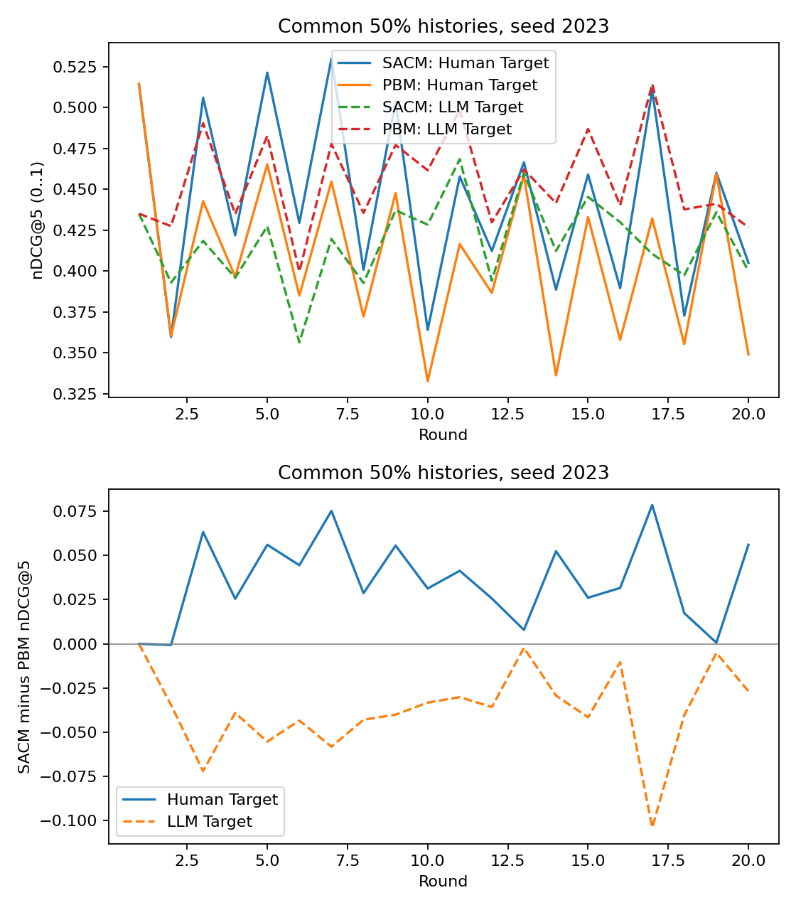

# 公共历史复评：辅助探索

验收通过，1个seed；只验收所选配对运行。

相同50%历史比例和相同具体赋值下，比较不同模型状态。native使用实际反馈比例但新公共随机抽样，并非GPU日志精确重现。

| 指标组 | 指标 | 第2–20轮配对均值 | seed间SD |
|---|---|---:|---:|
| Human | MAP1 | -0.002977 | 不可估计 |
| Human | MAP3 | -0.001238 | 不可估计 |
| Human | MAP5 | -0.001676 | 不可估计 |
| Human | Recall3 | +0.000962 | 不可估计 |
| Human | Recall5 | +0.000000 | 不可估计 |
| Human | nDCG1 | -0.002977 | 不可估计 |
| Human | nDCG3 | -0.000673 | 不可估计 |
| Human | nDCG5 | -0.001260 | 不可估计 |
| Human Target | MAP1 | +0.036060 | 不可估计 |
| Human Target | MAP3 | +0.039058 | 不可估计 |
| Human Target | MAP5 | +0.037808 | 不可估计 |
| Human Target | Recall3 | +0.042737 | 不可估计 |
| Human Target | Recall5 | +0.037173 | 不可估计 |
| Human Target | nDCG1 | +0.036060 | 不可估计 |
| Human Target | nDCG3 | +0.040005 | 不可估计 |
| Human Target | nDCG5 | +0.037733 | 不可估计 |
| LLM | MAP1 | +0.003970 | 不可估计 |
| LLM | MAP3 | -0.000406 | 不可估计 |
| LLM | MAP5 | +0.000750 | 不可估计 |
| LLM | Recall3 | -0.004962 | 不可估计 |
| LLM | Recall5 | +0.000000 | 不可估计 |
| LLM | nDCG1 | +0.003970 | 不可估计 |
| LLM | nDCG3 | -0.001595 | 不可估计 |
| LLM | nDCG5 | +0.000469 | 不可估计 |
| LLM Target | MAP1 | -0.033053 | 不可估计 |
| LLM Target | MAP3 | -0.035935 | 不可估计 |
| LLM Target | MAP5 | -0.037067 | 不可估计 |
| LLM Target | Recall3 | -0.040872 | 不可估计 |
| LLM Target | Recall5 | -0.045504 | 不可估计 |
| LLM Target | nDCG1 | -0.033053 | 不可估计 |
| LLM Target | nDCG3 | -0.037179 | 不可估计 |
| LLM Target | nDCG5 | -0.039151 | 不可估计 |
| dev candidates | exposure@3 | -0.062637 | 不可估计 |
| dev candidates | exposure@5 | -0.043332 | 不可估计 |

指标为0–1；统计单位为seed，无显著性结论。辅助dev曝光不能替代主终点。native与50%之间的差异混合历史构成及具体赋值变化，不能称为完整因果分解。

Relative Delta及两侧原始值见relative_delta.csv；无差异、升高、降低及效用代价均保留。本次只评native和50%，不声称已完成0/50/100%历史敏感性扫描。

图中上下两面板分别展示两侧原始nDCG5及SACM−PBM差。检查固定历史后差异是否仍存在，勿把相对差变化直接当作整体效用改善。
