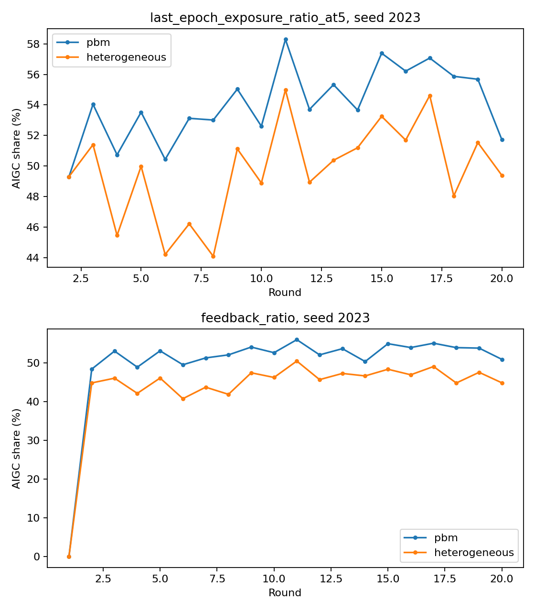
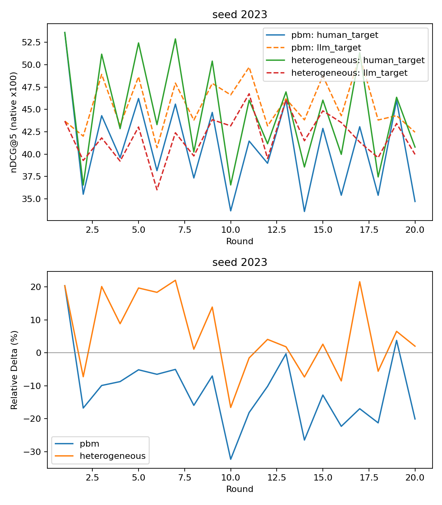

# SACM快速探索：教授汇报分析

本报告只验收所选配对单元，不代表完整15次或35次矩阵完成。

独立seed数：1；第2–20轮末epoch曝光差均值：-4.3217个百分点。

| seed | PBM平均曝光 | SACM平均曝光 | SACM−PBM（百分点） |
|---|---:|---:|---:|
| 2023 | 54.0365% | 49.7148% | -4.3217 |

可用于汇报的事实：在本次1个随机起点上，SACM的第2–20轮平均AIGC曝光相对PBM总体较低，平均差为-4.3217个百分点。这描述所测仿真轨迹，不等于稳定去偏或公平性改善；跨轮是否反转与推荐质量代价须结合下图判断。

曝光和最后epoch反馈分别展示；首轮曝光缺失不填0。变化是否持续、消失或反转须读完整轨迹。

Relative Delta与Human Target、LLM Target原始值一起解释；方向反转不自动等于改善。

本结果描述比例反馈仿真中的机制效应，不声称真实用户、公平性改善或统计显著性。各条件原生效用使用自身历史组成。
